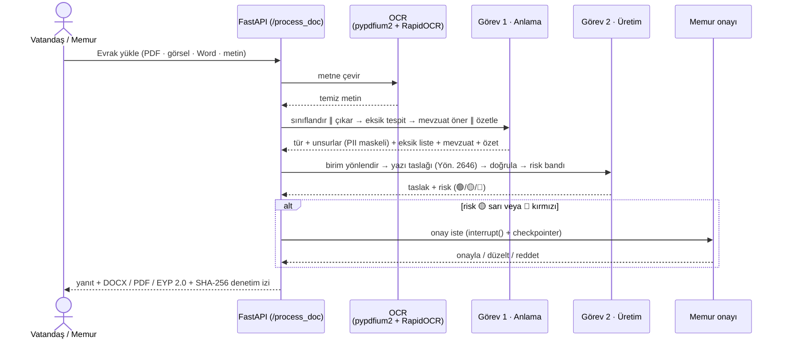
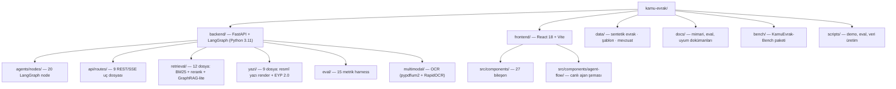
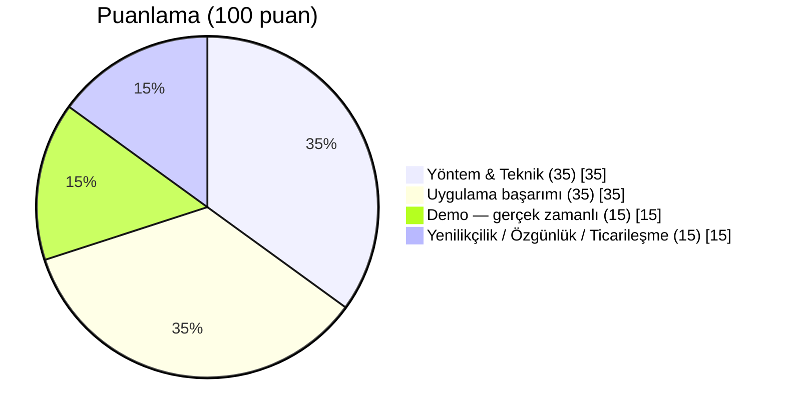
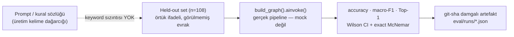
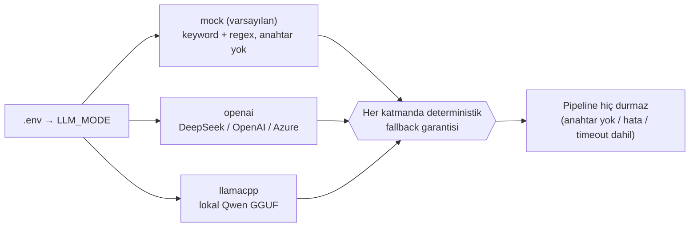
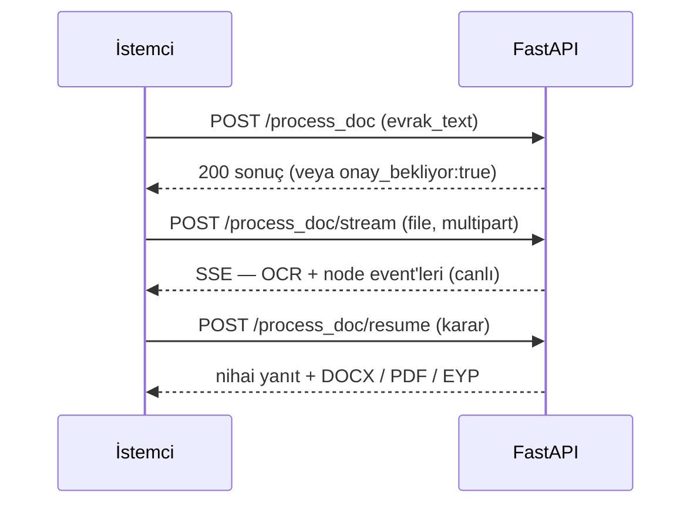

# kamu-evrak — Kamu Evrak ve Yazışma Süreçleri için Akıllı Agent Destek Sistemi

[](https://github.com/cozalss/TasnifX-TeknoFest/actions/workflows/ci.yml)

[](LICENSE)


> **TEKNOFEST 2026 — Yapay Zeka Dil Ajanları Yarışması · 1. Senaryo**

Kamu kurumuna gelen evrakı **okuyan, sınıflandıran, eksiğini bulan, mevzuat öneren ve resmî
yazı taslağını hazırlayan** çok-ajanlı (LangGraph) sistem — belge başına **~10 sn ve ~$0.001**;
**anahtarsız/offline modda dahi uçtan uca çalışır**, insan onayı olmadan hiçbir yazı çıkmaz.

**Hızlı gezinme:** [Hızlı başlangıç](#-hızlı-başlangıç-anahtar-gerekmez) ·
[Mimari](#-mimari) · [Proje yapısı](#-proje-yapısı) · [Şartname eşlemesi](#-şartname--rubrik-eşlemesi) ·
[Puanlama](#-puanlama-kriterleri) · [Skorlar](#-değerlendirme-sonuçları-dürüst) ·
[Neden farklı](#-neden-farklı)

- **Görev 1 — Anla:** oku (OCR/metin) → türü sınıflandır (19 tür) → bilgi çıkar (PII maskeli) →
  eksiği tespit et → ilgili mevzuatı öner (BM25 RAG) → özetle
- **Görev 2 — Üret:** resmî yazı taslağı — Resmî Yazışma Yönetmeliği (CB 2646/2020, kısaca
  "Yön. 2646") formatında → doğrula (uydurma-veto) → risk bandı → memur onayı (HITL) →
  doğru birime yönlendir → bilgilendir → gerekirse eksik bilgi iste

Lisans **MIT**, AGPL bağımlılığı yok (PDF için PyMuPDF yerine `pypdfium2`).

---

## 🚀 Hızlı başlangıç (anahtar gerekmez)

```bash
# Backend — LLM anahtarı GEREKMEZ (mock mod, deterministik)
cd backend
uv sync
cp ../.env.example ../.env            # opsiyonel: gerçek LLM/DB için doldur
uv run main.py                        # http://localhost:8000/docs — reload açık,
                                      # telefonla QR yükleme için LAN'a açık (0.0.0.0)

# Frontend
cd ../frontend
npm install
npm run dev                           # http://localhost:5173
```

Gerçek LLM (üretim doğruluğu) için `.env`:

```bash
LLM_MODE=openai
OPENAI_BASE_URL=https://api.deepseek.com
OPENAI_LLM_MODEL=deepseek-v4-flash
OPENAI_API_KEY=sk-...
VITRIN_MODU=1        # demo profili: HITL + clarifier + CRAG + hız (belge ~10 sn)
```

Gereksinimler: **Python 3.11+ · [uv](https://docs.astral.sh/uv/) · Node 22+** (yalnız frontend;
dev/build Node 20'de de çalışır, `npm test` glob'u Node 21+ ister) — GPU gerekmez.

> **Telefonla QR yükleme:** backend LAN'a açık başlar; Windows ilk açılışta güvenlik duvarı
> penceresi gösterirse **"İzin Ver"** deyin (sorun sürerse `scripts/demo-mobil.ps1`).
> Telefon, bilgisayarla **aynı Wi-Fi/hotspot** ağında olmalı (misafir ağlarında cihazlar
> birbirini göremeyebilir — garantili yol: telefon hotspot'u).
>
> **Panel girişi (login):** kullanıcı hesapları PostgreSQL/Supabase ister — kurulum ve seed
> adımları: [`backend/db/README.md`](backend/db/README.md). DB olmadan API + `/docs` tam çalışır.
Testler: `cd backend && uv run python -m pytest -q` (**1516 test · 92 modül**, CI'da mock modda koşar) ·
frontend saf-mantık testleri: `cd frontend && npm test` (**104 test**, `node --test`, bağımlılıksız) ·
Mevzuat RAG ağır ekleri (opsiyonel): `uv sync --extra rag`

---

## 🧭 Mimari

Tek LangGraph boru hattı — **20 node'a kadar** (varsayılan 15; gelişmiş node'lar ENV-bayraklı).
`siniflandir ∥ cikar` ve `mevzuat_oner ∥ ozetle` **paralel** koşar; OCR graf-öncesi yapılır
(graf saf metin üzerinde → test edilebilir).

```mermaid
flowchart LR
    EVRAK["Evrak<br/>PDF · görsel · Word · metin"] --> OKU["OCR / metin çıkarımı"]
    subgraph G1["Görev 1 · Anlama"]
        SINIF["sınıflandır<br/>19 tür"]
        CIKAR["bilgi çıkar<br/>PII maskele"]
        EKSIK["eksik tespit<br/>3071 m.4"]
        DECOMP["çok-konulu ayır"]
        MEV["mevzuat öner<br/>BM25 + rerank + NLI"]
        OZET["özetle"]
        SINIF --> EKSIK
        CIKAR --> EKSIK
        EKSIK -.-> DECOMP
        DECOMP --> MEV
        DECOMP --> OZET
    end
    subgraph G2["Görev 2 · Üretim"]
        BIRIM["birim yönlendir"]
        TASLAK["resmî yazı taslağı<br/>Yön. 2646"]
        VERIFY["doğrula<br/>uydurma-veto + lint"]
        RISK["risk bandı<br/>yeşil / sarı / kırmızı"]
        HITL["memur onayı<br/>HITL"]
        BIRIM --> TASLAK --> VERIFY --> RISK
        RISK -.->|sarı·kırmızı| HITL
    end
    OKU --> SINIF
    OKU --> CIKAR
    MEV --> BIRIM
    OZET --> BIRIM
    RISK --> SON["arşiv SDP + yasal süre<br/>+ SHA-256 denetim izi"]
    HITL --> SON
    SON --> CIKTI(["yanıt + DOCX / PDF / EYP 2.0"])
```



Kesikli kenarlar ENV-bayraklı node'lar (temel akış birebir korunur, demo için açılır).
Ayrıntılı topoloji: [`docs/03-mimari.md`](docs/03-mimari.md).

**Dayanıklılık ilkesi:** LLM kullanan **her katmanın deterministik fallback'i vardır**
(keyword/regex/şablon) — anahtar yok, model çökmüş, zaman aşımı: akış hiç durmaz.
2026-07 güçlendirme dalgasıyla **10 varsayılan-açık LLM katmanı** eklendi: OCR düzeltme,
sınıflandırma eskalasyonu (→ `deepseek-v4-pro`), risk açıklaması, JSON retry + önbellek,
2646 lint oto-düzeltme, verify grounding, SDP seçici, sohbet araç döngüsü, rerank, NLI —
hepsi aynı ilkeyle: **LLM iyileştirir, fallback garanti eder.** (CRAG düğümü vitrin
profilinde açılır; açıldığında o da LLM'li sürümüyle koşar.)

---

## 🧩 İki zorunlu görev — uçtan uca akış

Şartname §9, ikisi de eksiksiz koşmadan sistemi "tamamlanmamış" sayar. Aşağıdaki akış,
bir evrakın yüklenmesinden nihai yazının çıkmasına kadar geçen gerçek adımları gösterir
(HITL yalnız 🟡/🔴 risk bandında devreye girer — 🟢 otomatik geçer):



Kod karşılığı ve kanıt için: [Şartname / rubrik eşlemesi](#-şartname--rubrik-eşlemesi).

---

## 🗂️ Proje yapısı



| Klasör | İçerik | Örnek dosyalar |
|---|---|---|
| [`backend/agents/nodes/`](backend/agents/nodes/) | 20 LangGraph node — pipeline'ın kalbi | `siniflandir.py` · `mevzuat_oner.py` · `verify.py` · `yazi_taslak.py` |
| [`backend/api/routes/`](backend/api/routes/) | REST + SSE uçları | `process_doc.py` · `sohbet.py` · `sla.py` · `mevzuat.py` · `yazi.py` |
| [`backend/retrieval/`](backend/retrieval/) | Mevzuat RAG altyapısı | `hybrid_search.py` · `reranker.py` · `atif_grafi.py` (GraphRAG-lite) |
| [`backend/yazi/`](backend/yazi/) | Resmî yazı render + EYP 2.0 paketi | `renderer.py` · `dayanak.py` · `eyp.py` · `sdp_plani.py` |
| [`backend/eval/`](backend/eval/) | 15 metrik harness | `competition_scorecard.py` · `heldout_eval.py` · `stats.py` |
| [`backend/multimodal/`](backend/multimodal/) | OCR (offline, AGPL-free) | `ocr.py` |
| [`frontend/src/components/`](frontend/src/components/) | 27 React bileşeni + canlı ajan akışı | `PanelView.jsx` · `CanliAjanAkisi.jsx` · `MuzakereKurulu.jsx` |
| [`data/`](data/) | %100 sentetik evrak, Jinja2 şablon, mevzuat korpus | `synthetic/` · `templates/` · `mevzuat/` |
| [`docs/`](docs/) | Mimari, eval, uyum dokümanları | [`03-mimari.md`](docs/03-mimari.md) · [`sartname-uyum-matrisi.md`](docs/sartname-uyum-matrisi.md) |
| [`bench/`](bench/) | KamuEvrak-Bench (6 görev, veri kartlı) | [`bench/README.md`](bench/README.md) |

---

## ✨ Öne çıkanlar (her iddia koda bağlı)

| | |
|---|---|
| 🧩 **Çok-konulu ayrıştırma** | Tek dilekçedeki birden çok istek alt-taleplere bölünür; her biri ayrı **tür + birim + yasal süre** alır → otomatik havale — [`nodes/decompose.py`](backend/agents/nodes/decompose.py) |
| 🚦 **Ölçülmüş risk bandı + koşullu onay** | Üretilen yazıya trafik ışığı: 🟢 otomatik geçer, 🟡🔴 memur onayına durur (`interrupt()` + checkpointer). Skor sabit katsayı değil **ölçüm**: `ağırlık = ciddiyet × isabet`, isabet bağımsız oracle'la sayılıp Wilson alt sınırı olarak yazılır, belge skoru noisy-OR — [`agents/risk_agirlik.py`](backend/agents/risk_agirlik.py) · [`eval/risk_calibration.py`](backend/eval/risk_calibration.py) |
| 🏛️ **Bürokrasi Kurulu (çok-turlu müzakere)** | Hukuk + üslup + vatandaş-odaklılık + birim amiri perspektifli ajanlar taslağı **gerçek çok-turlu DEBATE** ile tartışır; öneriler çapalı-düzenleme (anchored-edit) olarak deterministik uygulanır, turlar SSE ile canlı açılır — [`agents/kurul.py`](backend/agents/kurul.py) |
| 📏 **Yönetmelik-lafzı dayanaklı 2646 denetimi** | 13 kural (başlık/sayı/ilgi/muhatap/kapanış/imza/ek/dağıtım…) — her bulgu yönetmelik **maddesinin gerçek lafzını** (mevzuat.gov.tr PDF'inden doğrulanmış korpus) + somut düzeltme önerisini taşır; çıkarımsal sinyal asla yanlış-pozitif SARI üretmez — [`agents/yazi_lint.py`](backend/agents/yazi_lint.py) |
| 📣 **Yapısal vatandaş bilgilendirmesi** | GOV.UK 3'lü desen (*ne oldu / sırada ne var / ne yapmalısınız*): iskelet deterministik, LLM yalnız tek paragrafı yazar ve **uydurma-guard'dan** (belge-dışı ad/sayı veto) geçer; 4982 itiraz yolu + 3071 gerekçe hakkı notları otomatik — [`nodes/finalize.py`](backend/agents/nodes/finalize.py) |
| 💬 **Sohbet asistanı (araç döngülü)** | "Gecikmiş evraklarım hangileri?" → **15 niyet, 10 kullanıcı-kapsamlı veri aracı**, çok-adımlı JSON araç döngüsü (maks. 3 tur), SSE stream, onay/reddet el-sıkışması — [`api/routes/sohbet.py`](backend/api/routes/sohbet.py) · [`docs/09`](docs/09-sohbet-asistani.md) |
| 🗂️ **SDP otomatik dosya kodu** | Devlet Teşkilatı **Standart Dosya Planı (2005/7)** kodunu gerekçesiyle otomatik atar (TR'de emsalini bilmiyoruz) — [`agents/sdp_katalog.py`](backend/agents/sdp_katalog.py) |
| 📦 **EYP 2.0 paket çıktısı** | e-Yazışma Teknik Rehberi uyumlu paket iskeleti (ÜstYazı + Üstveri + SHA-512) → EBYS'ye doğrudan girebilir — [`yazi/eyp.py`](backend/yazi/eyp.py) |
| 🛡️ **PII maskeleme** | TCKN / telefon / IBAN bulut çağrısından **önce** maskelenir; ham kişisel veri sistemde tutulmaz |
| 🚫 **Anti-halüsinasyon** | Deterministik uydurma-veto (**false-veto = 0**) + NLI atıf-gerekçelendirme; emin olunmayan madde `[DOĞRULA:]` işaretli |
| 📚 **Gerçek RAG + atıf grafiği** | 233 mevzuat / 1508 madde-chunk üzerinde **BM25** + model-indirmesiz DeepSeek listwise rerank + **GraphRAG-lite**: maddenin atıf verdiği mevzuata 1-hop genişleme — [`retrieval/atif_grafi.py`](backend/retrieval/atif_grafi.py) |
| ⏰ **Yasal süre triyajı + eskalasyon** | Mevzuat-dayanaklı cevap süresi (3071 m.7 = 30 gün, 4982 m.11 = 15 iş günü) → GECİKMİŞ/KRİTİK rozetleri, kuyruk SLA önizlemesi — [`api/routes/sla.py`](backend/api/routes/sla.py) |
| 🔗 **Denetim izi** | Tamper-evident **SHA-256 hash-zinciri**: her halka öncekini mühürler; arayüzde halka halka incelenebilir + kopyalanabilir — [`nodes/denetim_izi.py`](backend/agents/nodes/denetim_izi.py) |
| 🔎 **Kanıt-vurgu** | Çıkarılan her unsurun ham (maskeli) evraktaki yeri işaretli — "bunu nereden buldun?" sorusuna görsel cevap |
| ⚡ **Gerçek zamanlı demo** | SSE ile canlı ajan hat şeması; özet ve taslak token-token; Ctrl+K komut paleti, PDF önizleme, canlı mevzuat kütüphanesi |

---

## 📋 Şartname / rubrik eşlemesi

Şartname §9'daki her zorunlu adımın koddaki karşılığı ve kanıtı:

| Şartname adımı | Pipeline karşılığı | Kanıt |
|---|---|---|
| G1 · Belgeyi oku (OCR) | pypdfium2 + RapidOCR (offline) + python-docx | [`multimodal/ocr.py`](backend/multimodal/ocr.py) · CER 0.112 ölçümü [`eval/runs/ocr_eval.json`](backend/eval/runs/ocr_eval.json) |
| G1 · Türü sınıflandır | `siniflandir` — 19 tür, few-shot + eskalasyon + fallback | [`nodes/siniflandir.py`](backend/agents/nodes/siniflandir.py) · held-out %95.5 (n=22 ön-ölçüm) |
| G1 · Bilgi unsurlarını çıkar | `cikar` — gönderen/kurum/konu/tarih/sayı/talep, PII maskeli | [`nodes/cikar.py`](backend/agents/nodes/cikar.py) |
| G1 · Eksik tespit + iste | `eksik_tespit` + `clarifier` (dur-ve-sor) | [`nodes/eksik_tespit.py`](backend/agents/nodes/eksik_tespit.py) |
| G1 · Mevzuat öner | `mevzuat_oner` — BM25 + rerank + NLI + atıf grafiği | [`nodes/mevzuat_oner.py`](backend/agents/nodes/mevzuat_oner.py) |
| G1 · Özetle | `ozetle` — key-fact koruyan sadık özet | faithfulness 1.0 ([karne](backend/eval/runs/competition_scorecard.json)) |
| G2 · Resmî yazı taslağı | `yazi_taslak` — üst/cevabi/bilgilendirme/olur, Yön. 2646 | format-uyum 1.0 · [`data/templates/`](data/templates/) (7 Jinja2 şablon) |
| G2 · Resmî üslup + doğrula | `verify` — 2646 lint (madde madde) + uydurma-veto + tutarlılık | [`nodes/verify.py`](backend/agents/nodes/verify.py) · false-veto 0 |
| G2 · Birim yönlendir | `route_birim` — 9 birim, top-k + alternatifler | [`nodes/route_birim.py`](backend/agents/nodes/route_birim.py) |
| G2 · Kullanıcıyı bilgilendir | `finalize` + sohbet asistanı | [`api/routes/sohbet.py`](backend/api/routes/sohbet.py) |

Tam matris: [`docs/sartname-uyum-matrisi.md`](docs/sartname-uyum-matrisi.md).

---

## 🏆 Puanlama kriterleri

Şartname 100 puanı dört boyuta böler; her biri README'de somut kanıta bağlanır:



| Boyut | Puan | Nereye bak |
|---|---|---|
| Yöntem & Teknik | 35 | [Mimari](#-mimari) + [`docs/method.md`](docs/method.md) |
| Uygulama başarımı | 35 | [Değerlendirme sonuçları](#-değerlendirme-sonuçları-dürüst) |
| Demo (gerçek zamanlı avantaj) | 15 | [`docs/demo-senaryosu.md`](docs/demo-senaryosu.md) |
| Yenilikçilik / Özgünlük / Ticarileşme | 15 | [Neden farklı](#-neden-farklı) + [`docs/ticarileşme.md`](docs/ticarileşme.md) |

---

## 📊 Değerlendirme sonuçları (dürüst)

Tüm ölçümler **gerçek LangGraph pipeline'ını** koşar (`build_graph().ainvoke`); fark yalnız LLM
modu ve veri setidir. Held-out setler örtük ifadeli, üretim sözlüğünden **farklı** evraklardır
(keyword sızıntısı yok — aşağıdaki ayrım kasıtlı ve ölçülüdür). Tüm artefaktlar repodadır —
sayılar yeniden üretilebilir.



### Held-out (görülmemiş evrak, n=108 = 2×54) — ölçüm modeli DeepSeek (`deepseek-chat`)

> ⚠️ **2026-07-24:** `deepseek-chat` API'den kaldırıldı; üretim modeli `deepseek-v4-flash`.
> Aşağıdaki skorlar **eski modelle** ölçülmüştür ve yeni modelle **yeniden ölçülmemiştir**
> (ölçüm kaydı tahrif edilmesin diye model adı olduğu gibi bırakıldı).

| Metrik | Set-1 (n=54) | Set-2 (n=54) |
|---|---|---|
| Sınıflandırma accuracy (sıkı, 19 sınıf) | 0.870 | **0.907** |
| Sınıflandırma macro-F1 (sıkı) | 0.864 | **0.907** |
| Operasyonel accuracy *(işlem-eşdeğer tür grubu doğru)* | 0.907 | **0.963** |
| Yönlendirme Top-1 | **0.907** | **0.907** |

Artefaktlar: [`heldout_deepseek_set1_n54_fixed.json`](backend/eval/runs/heldout_deepseek_set1_n54_fixed.json) ·
[`heldout_deepseek_set2_n54_fixed.json`](backend/eval/runs/heldout_deepseek_set2_n54_fixed.json) ·
detay [`docs/benchmark/llm-heldout.md`](docs/benchmark/llm-heldout.md).

> ⚠️ **Dürüstlük:** `_fixed` sonekli artefaktlar route_birim düzeltmesi SONRASI koşulardır;
> aynı klasördeki `_n54.json` dosyaları düzeltme-öncesi tarihsel kayıttır (Top-1 0.537/0.593) —
> ikisini de siliyor değil, yan yana saklıyoruz. Önceki üretim modeli gpt-4o'nun tam-set
> çapraz-referansı ([`heldout_gpt4o_set1.json`](backend/eval/runs/heldout_gpt4o_set1.json))
> sınıflandırmada ~0.93 ile uyumludur; routing satırları düzeltme öncesine ait olduğundan
> artık referans verilmez.

### Geniş in-domain karne (n=216, gerçek LLM, kasıtlı zor set)

216 evraklık set **bilerek zor** kurgulanmıştır (örtük ifade, zorluk kademeli):

| Metrik (n=216, `llm_mode=openai`) | Değer |
|---|---|
| Sınıflandırma accuracy / macro-F1 | 0.662 / 0.666 (kolay 0.75 · orta 0.72 · zor 0.51) |
| Eksik-bilgi precision / recall | **1.000** / 0.549 *(recall örtük eksiklerden düşük; precision 1.0 = yanlış alarm yok)* |
| Özet faithfulness (halüsinasyon) | **1.000** |
| Yönlendirme Top-1 / Top-3 | 0.773 / **0.917** |
| Taslak format-uyumu (2646) / false-veto | **1.000** / **0** |
| Etik tutarlılık *(kimlik takasında karar değişmezliği)* | 0.889 / 0.944 |

Artefakt: [`competition_scorecard.json`](backend/eval/runs/competition_scorecard.json)
(git-sha damgalı) · yeniden üret: `uv run python -m eval.competition_scorecard --check`.
Held-out ile fark **setin zorluğundandır** — ikisini de olduğu gibi raporluyoruz; manşet
için kolay seti seçmiyoruz. 1.0 skorlar deterministik kural-tabanlı kontrollerdir (ölçüm
tanımları: [`docs/06-eval-harness.md`](docs/06-eval-harness.md)).

### Tabanlar ve yardımcı ölçümler

- **Anahtarsız taban** (`LLM_MODE=mock`, leak-free held-out set-2): accuracy **0.694** — bu bir
  alt sınırdır; LLM'siz modda bile sistemin ayakta kaldığını gösterir.
  [`heldout_mock_set2.json`](backend/eval/runs/heldout_mock_set2.json)
  > Not: 0.694 (held-out set-2) ile 0.662 (n=216 zor in-domain) **farklı setlerdir, doğrudan
  > kıyaslanamaz.** Aynı held-out ailesinde gerçek LLM 0.935'e çıkar (set-1, n=108); mock'un
  > 216'lık zor setteki koşusu ve tam aynı-set DeepSeek karşılaştırması yol haritasındadır.
- **OCR** (taranmış PDF, RapidOCR): CER **0.112** / WER 0.514 (n=3) — [`ocr_eval.json`](backend/eval/runs/ocr_eval.json)
- **Mevzuat retrieval** (BM25, yeniden-üretilebilir: `uv run python -m eval.retrieval_eval`):
  Recall@1 0.688 / Recall@3 **0.875** / MRR 0.760 (n=16, 11 Tem 2026 yeniden ölçüm; üstüne
  DeepSeek listwise rerank + NLI katmanı biner — ölçüm tanımı: [`docs/method.md`](docs/method.md))
- **İstatistik altyapısı**: Wilson CI + exact McNemar + bootstrap-BCa, saf Python — [`eval/stats.py`](backend/eval/stats.py)
- **KamuEvrak-Bench**: 6 görevli, %100 sentetik, veri-kartlı bench paketi — [`bench/`](bench/)

---

## 🥊 Neden farklı

| Yetenek | Manuel EBYS süreci | Tek LLM çağrısı | **kamu-evrak** |
|---|---|---|---|
| Çok-konulu dilekçe | 3 kez fotokopi, 3 ayrı havale | Tek özet, kayıp talepler | Alt-taleplere böler, her birine ayrı tür+birim+süre |
| Halüsinasyon riski | — | Kaynaksız madde uydurabilir | Uydurma-veto + NLI + `[DOĞRULA:]` protokolü |
| Kişisel veri | Fiziksel dosyada açık | Buluta ham gider | Çağrıdan **önce** maskeleme; on-prem `KVKK_MODU` |
| Denetlenebilirlik | Islak imza + zimmet defteri | Yok | SHA-256 hash-zinciri + HITL onay kaydı |
| Anahtar/internet yoksa | Çalışır (elle) | Durur | **Deterministik fallback ile uçtan uca çalışır** |
| Arşiv/EBYS entegrasyonu | Elle SDP kodu | Yok | Otomatik SDP kodu + EYP 2.0 paketi |
| Maliyet / belge | Memur-dakikaları | değişken | **~$0.001** (DeepSeek) · ~10 sn |

---

## 🤖 LLM modları — kurumun tercihine göre konuşlandırma

`.env` → `LLM_MODE`. OpenAI-uyumlu istemci `base_url` ile DeepSeek/OpenAI/Azure'a bağlanır — kod değişikliği yok.



| Mod | LLM | Anahtar | Ne için |
|---|---|---|---|
| `mock` (varsayılan) | yok — keyword+regex | gerekmez | demo / CI / offline; skor tabanı |
| `openai` | **DeepSeek `deepseek-v4-flash`** (önerilen) / `deepseek-v4-pro` / OpenAI / Azure | `OPENAI_API_KEY` | üretim doğruluğu (~$0.001/belge) |
| `llamacpp` | lokal Qwen GGUF | — | on-prem / gizlilik |

İki **profil anahtarı** hepsinin üstünde: `VITRIN_MODU=1` (jüri demosu: HITL + clarifier +
CRAG + atıf genişletme + hız profili → belge ~10 sn) · `KVKK_MODU=1` (yerel Ollama'ya zorlar —
veri kurumdan çıkmaz).

---

## 🔌 API (curl)



```bash
# Hazır metinle (OCR'sız)
curl -X POST localhost:8000/process_doc -H "Content-Type: application/json" \
  -d '{"evrak_text":"Sayın Valilik, ... talep ederim. Ad Soyad, imza"}'

# Dosya yükle → SSE (OCR + canlı pipeline node event'leri)
curl -N -X POST localhost:8000/process_doc/stream -F "file=@ornek_evrak.pdf"
```

HITL açıkken `/process_doc` taslakta durur (`onay_bekliyor: true`), karar `/process_doc/resume`
ile verilir. Diğer uçlar: `/sohbet` + `/sohbet/stream` (asistan), `/sla/onizleme`,
`/mevzuat/*` (kütüphane + BM25 derin arama), `/yazi/render` (DOCX/PDF/EYP).

---

## 🔍 Sınırlar ve doğrulama (bilerek şeffaf)

- **Mevzuat referansları karar-destek amaçlıdır**: sistem emin olmadığı maddeyi `[DOĞRULA:]`
  ile işaretler; NLI desteği zayıfsa arayüz "insan incelemesi önerilir" der. Nihai hukuki
  doğrulama mevzuat.gov.tr üzerindendir.
- **Veri %100 sentetiktir** (şartname §6.5): gerçek kamu verisi/PII kullanılmadı; TCKN'ler
  checksum-geçerli fakat sahtedir. Bench veri kartı: [`bench/`](bench/).
- **Küçük örneklemler açıkça etiketli**: DeepSeek held-out n=22, OCR n=3 — büyütme yol
  haritasında; sayı büyütülene dek CI'lar raporlanır.
- **Ablasyon dürüstlüğü**: CRAG/verify A/B ölçümünde Δ≈0 çıktı; bunu gizlemiyoruz
  ([`docs/benchmark/ablation.md`](docs/benchmark/ablation.md)).
- Her çıktıda yasal uyarı: *"Bu sistem karar-destek amaçlıdır; nihai sorumluluk yetkili
  personeldedir."*

---

## 📚 Dokümanlar (`docs/`)

| Dosya | İçerik |
|---|---|
| [`00-yarisma-uygunluk.md`](docs/00-yarisma-uygunluk.md) | Şartname özeti + uygunluk kontrol listesi |
| [`sartname-uyum-matrisi.md`](docs/sartname-uyum-matrisi.md) | Şartname maddesi → kod → test tam matrisi |
| [`method.md`](docs/method.md) | Yöntem raporu (jüri teknik değerlendirmesi için) |
| [`03-mimari.md`](docs/03-mimari.md) | LangGraph node listesi + state şeması |
| [`06-eval-harness.md`](docs/06-eval-harness.md) | Metrik → puanlama eşlemesi |
| [`09-sohbet-asistani.md`](docs/09-sohbet-asistani.md) | Sohbet asistanı: niyet + araç döngüsü spesifikasyonu |
| [`benchmark/llm-heldout.md`](docs/benchmark/llm-heldout.md) | Held-out skorları (artefakt-destekli) |
| [`benchmark/ablation.md`](docs/benchmark/ablation.md) | CRAG/verify A/B — dürüst Δ raporu |
| [`data-card.md`](docs/data-card.md) | Sentetik veri kartı |
| [`07-model-lisanslari.md`](docs/07-model-lisanslari.md) | Model/lisans + AGPL notu |
| [`ticarileşme.md`](docs/ticarileşme.md) | Hedef kullanıcı, değer, iş modeli |
| [`demo-senaryosu.md`](docs/demo-senaryosu.md) | Jüri canlı demo senaryosu + internet-kesinti yedeği |

---

## ⚖️ Yarışma kuralları ve uyum

- **Açık kaynak (MIT)** — model ağırlıkları repoya yüklenmez (yalnız link + sürüm + lisans,
  [`docs/07`](docs/07-model-lisanslari.md)).
- **Gerçek kamu verisi YASAK** → %100 sentetik/kurgu evrak + kamuya açık mevzuat.
- **API anahtarı asla commit edilmez** (`.env` `.gitignore`'da).

## 👥 Takım

**TasnifX** — TEKNOFEST 2026 Yapay Zeka Dil Ajanları Yarışması, "Kamu Evrak ve Resmî Yazışma
Süreçleri İçin Çok Ajanlı (Multi-Agent) Akıllı Destek Sistemi" kategorisi.
Başvuru: 04 Temmuz 2026 (Takım ID 1001572 · Başvuru ID 5372496).

- cem özal
- Gizem Fatma Kılıç
- Ecem Tüysüz
- Can Eltayeb

**Danışman:** Sevgi Koyuncu Tunç

## Lisans

[MIT](LICENSE) © kamu-evrak ekibi · Katkı: [CONTRIBUTING.md](CONTRIBUTING.md) ·
Sürüm geçmişi: [CHANGELOG.md](CHANGELOG.md)
