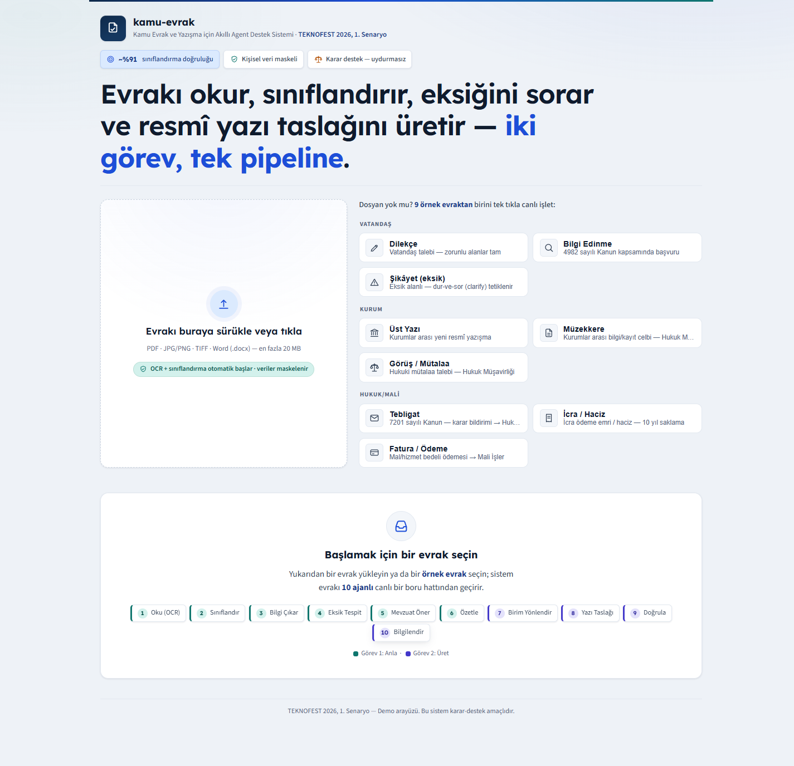
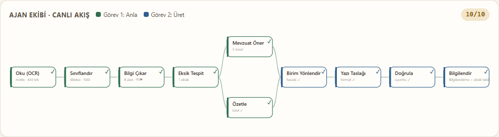
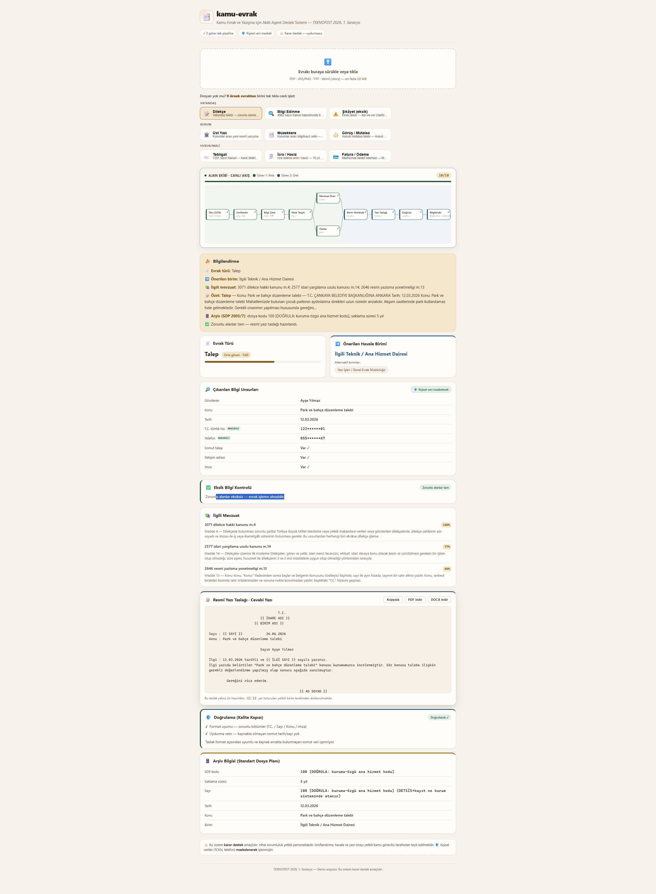
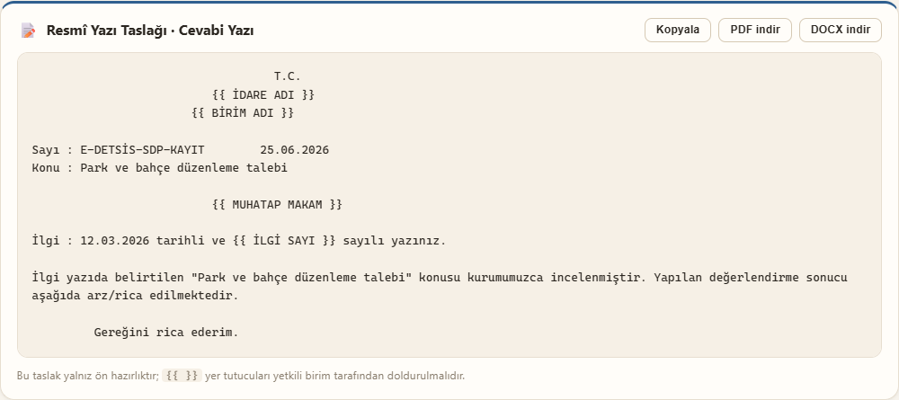

# kamu-evrak — Kamu Evrak ve Yazışma Süreçleri için Akıllı Agent Destek Sistemi

> **TEKNOFEST 2026 — Yapay Zeka Dil Ajanları Yarışması, 1. Senaryo**
> Çok-ajanlı (LangGraph) yapay zeka ile kamu evrakını **oku → sınıflandır → bilgi çıkar →
> eksik tespit et → mevzuat öner → özetle** (Görev 1) ve **resmî yazı taslakla → birime
> yönlendir → kullanıcıyı bilgilendir** (Görev 2).

Bu depo, mevcut **ADALET-AGENT** altyapısından (çok-ajan + OCR + Türkçe RAG + grounding +
canlı SSE demo) yeniden-kullanılabilir kod **kopyalanarak** kuruldu; ADALET'e dokunulmadı.
Lisans: **MIT** (AGPL bağımlılık yok — PyMuPDF yerine pypdfium2).

## Özellikler

### Görev 1 — Evrak Sınıflandırma ve İçerik Analizi
- **OCR / metin okuma:** dijital PDF → pypdfium2 (kusursuz Türkçe); taranmış/foto → RapidOCR
  (offline); Word → python-docx; opsiyonel OpenAI vision.
- **Sınıflandırma:** 19 evrak türü (config taksonomisi; `belirsiz` abstention dahil) — few-shot
  LLM + keyword pre-filter + mock fallback.
- **Bilgi çıkarımı:** gönderen / kurum / konu / tarih / sayı / talep — **PII (TCKN, telefon)
  maskelenerek**; ham kişisel veri arayüze ulaşmaz.
- **Eksik-bilgi tespiti:** tür-bağımlı zorunlu-alan şeması → eksikse clarify soruları üretir.
- **Mevzuat önerisi:** kamuya açık mevzuat üzerinde BM25/keyword retrieval (RAG opsiyonel).
- **Özet:** key-fact'leri koruyan kısa özet.

### Görev 2 — Resmî Yazı Taslaklama ve Birim Yönlendirme
- **Birim yönlendirme:** 9 birim arasında top-k öneri + güven + alternatifler.
- **Resmî yazı taslağı:** üst / cevabi / bilgilendirme / olur — jinja2 şablon + resmî üslup.
- **Taslak indirme:** **PDF / DOCX** çıktı (`/yazi/taslak`).
- **Bilgilendirme:** vatandaşa/kullanıcıya özet + eksik bilgi talebi.

### Demo / arayüz
- **Canlı Ajan Akış Şeması:** SSE ile node'lar gerçek zamanlı "yanar" (düşünen-sistem hissi).
- **Sonuç kartları:** evrak türü + güven, çıkarılan alanlar (🛡️ maskeli rozet), eksik bilgi,
  mevzuat, birim, yazı taslağı önizleme + indirme.
- **5 örnek evrak** (sahte-PII) — jüri dosya bulmadan tek tıkla farklı türleri canlı işletir.
- **Yasal disclaimer** her sonuçta: "Bu sistem karar-destek amaçlıdır; nihai sorumluluk
  yetkili personeldedir."
- a11y: klavye gezinme, ARIA, `prefers-reduced-motion`; saf React/Vite (ek dep yok).

## Eval skorları (mock taban)

> **GERÇEK LangGraph pipeline** ölçümü (`python -m eval.competition_scorecard`); LLM_MODE=`mock`
> → keyword/regex fallback koşar. **Skorlar tavan değil tabandır** — gerçek LLM modu yükseltir.
> Tam karne: [`docs/benchmark/scorecard.md`](docs/benchmark/scorecard.md).

| Metrik | Değer (%95 CI) |
|---|---|
| Sınıflandırma macro-F1 | **0.628** |
| Sınıflandırma accuracy | 0.587 [0.500, 0.669] |
| Eksik-bilgi recall (β=2) | **0.991** [0.951, 0.998] |
| Özet key-fact recall | **1.000** |
| Yönlendirme Top-1 | **0.643** [0.556, 0.721] |
| Yönlendirme Top-3 | 0.833 |
| Yazı türü doğruluğu | 0.936 |
| Adillik (counterfactual isim/cinsiyet) | **1.0000** [0.956, 1.000] |

Test paketi: **127 passed, 1 skipped** (`cd backend && uv run python -m pytest`).

## Ekran görüntüleri

> _Placeholder — gerçek görseller `docs/img/` altına eklenecek (PNG/GIF)._

| | |
|---|---|
|  |  |
|  |  |

Canlı akışı kayıt olarak görmek için: `docs/img/demo.gif` (internet-kesinti yedeği — bkz.
[`docs/demo-senaryosu.md`](docs/demo-senaryosu.md)).

## Hızlı başlangıç

```bash
# Backend (çekirdek iskelet — hafif, model indirmesi yok)
cd backend
uv sync
cp ../.env.example ../.env         # LLM_MODE=mock yeterli (anahtar gerekmez)
uv run uvicorn main:app --reload   # http://localhost:8000/docs

# Frontend (saf React + Vite; react/react-dom dışında ek dep yok)
cd ../frontend
npm install
npm run dev                        # http://localhost:5173
npm run build                      # üretim derlemesi → dist/
```

Tek komutla demo: `bash scripts/run-local-demo.sh`.
Mevzuat RAG (opsiyonel, ağır): `uv sync --extra rag` + `docker compose --profile rag up`.

## Demo akışı (jüri için)

1. **Örnek evrak** seç (ör. "Dilekçe") → ajan akış şeması canlı "yanar".
2. Sonuç kartlarını oku → 🛡️ **kişisel veri maskeli** rozeti, eksik-bilgi kontrolü, mevzuat,
   önerilen havale birimi.
3. **Resmî Yazı Taslağı** kartından **PDF/DOCX indir** (örnek-evrak akışında etkin).
4. "Şikâyet (eksik)" örneği → sistem eksik alanı yakalar, **clarify soruları** üretir.

Tam senaryo + **internet-kesinti yedeği**: [`docs/demo-senaryosu.md`](docs/demo-senaryosu.md).

## Uçtan-uca dene (curl)

```bash
# Hazır metinle (OCR'sız)
curl -X POST localhost:8000/process_doc -H "Content-Type: application/json" \
  -d '{"evrak_text":"Sayın Valilik, ... talep ederim. Ad Soyad, imza"}'

# Dosya yükle → SSE (OCR + pipeline node event'leri)
curl -N -X POST localhost:8000/process_doc/stream -F "file=@ornek_evrak.pdf"
```

## Mimari (özet)

```
START → siniflandir → cikar → eksik_tespit → [mevzuat_oner ∥ ozetle]
      → route_birim → yazi_taslak → finalize → END
```

Detaylar: [`docs/03-mimari.md`](docs/03-mimari.md). OCR graf-öncesi (API route) yapılır.

## Dokümanlar (`docs/`)

| Dosya | İçerik |
|---|---|
| `00-yarisma-uygunluk.md` | Şartname özeti + **takvim** + uygunluk kontrol listesi + teslim formatı |
| `01-resmi-yazisma-mevzuati.md` | Resmî Yazışma Yön. 2646 madde-madde + SDP + e-Yazışma |
| `02-evrak-taksonomi-routing.md` | Evrak türleri + birim havale + zorunlu alanlar |
| `03-mimari.md` | LangGraph node listesi + state şeması |
| `04-port-haritasi.md` | ADALET → kamu-evrak (KEEP/ADAPT/DROP) |
| `05-sentetik-veri-plani.md` | Sahte-PII veri üretimi + gold set |
| `06-eval-harness.md` | Metrik → puanlama (35/35/15/15) |
| `07-model-lisanslari.md` | Açık-kaynak model/lisans + AGPL notu |
| `08-yol-haritasi.md` | Düzeltilmiş takvim + haftalık plan |
| `demo-senaryosu.md` | **Jüri canlı demo senaryosu + internet-kesinti yedeği** |
| `benchmark/scorecard.md` | Tek-komut yarışma karnesi (GERÇEK pipeline ölçümü) |

## Yarışma kuralları (kritik)

- Açık kaynak (MIT) + **TAKP GitHub** zorunlu; model **ağırlıkları repoya YÜKLENMEZ** (link+lisans).
- **Gerçek kamu verisi YASAK** → sentetik/kurgu evrak + kamuya açık mevzuat (sahte PII).
- Her yanıtta uygunluk/disclaimer; uçtan-uca **canlı demo** (real-time avantaj).
- Takvim ve uygunluk kontrol listesi: [`docs/00-yarisma-uygunluk.md`](docs/00-yarisma-uygunluk.md).
