# Kamu Evrak — Screenshot Deck (WSA 2026)

> **Ekler için hazır.** Bu dosyadaki İngilizce başlıkları WSA formundaki
> *Evaluation & Additional Materials* alanına, görselleri de ek olarak yükleyin.
> Kareler **9 Ağustos 2026'da canlı sistemden** çekildi: `https://kamu-evrak.onrender.com`
>
> Anlatı tek bir belgenin yolculuğunu izler — jüri sistemi okumadan önce *anlar*.

---

## 01 — What it is

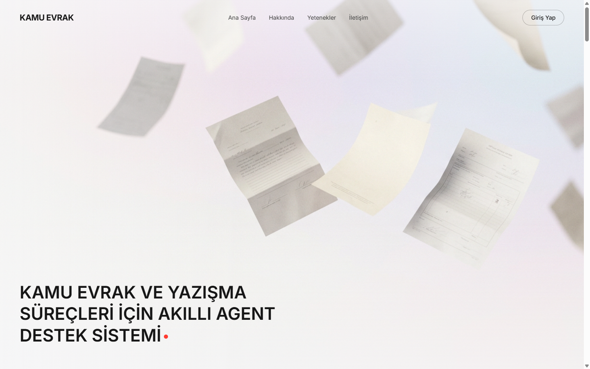

**Kamu Evrak — an AI assistant for public sector correspondence**

A working web application for Turkish public administration. It reads an incoming
official document, understands it, routes it to the correct unit, and drafts the
formal reply — with every legal citation traced to its source.

---

## 02 — Sixteen specialist agents, not one black box

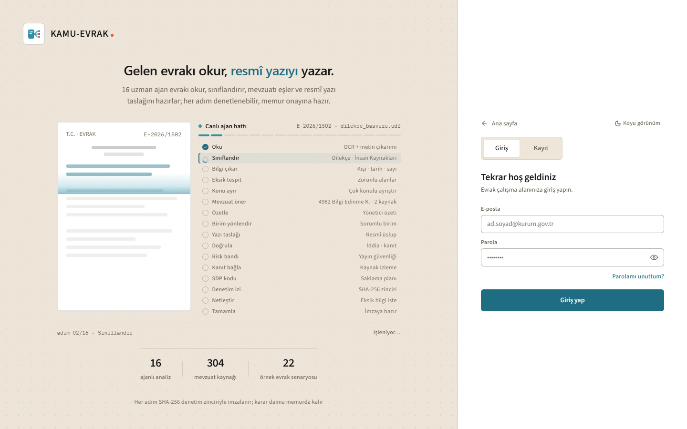

The sign-in screen shows the actual pipeline running live. Sixteen specialist steps —
read, classify, extract, detect missing fields, match legislation, summarise, route,
draft, verify, risk-band, archive, audit — each one inspectable.

*Every step is signed into a SHA-256 audit chain; the decision always stays with the
civil servant.*

---

## 03 — Legal deadlines, tracked

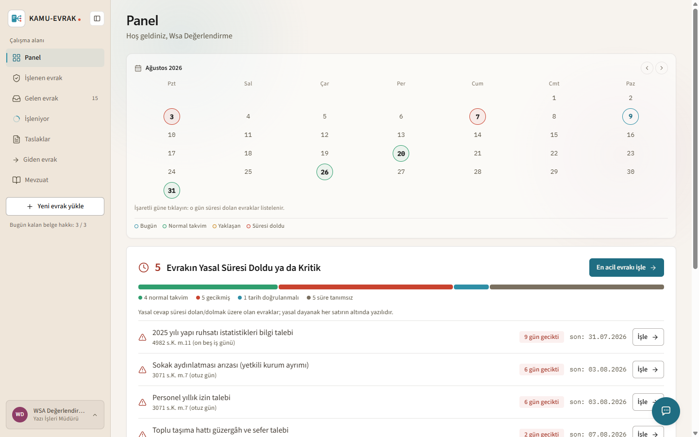

Turkish law sets binding response times for citizen petitions (Law 3071) and
information requests (Law 4982). Paper workflows miss them silently.

The dashboard surfaces what is overdue and what is about to be — each row citing the
specific article and the statutory limit ("4982 s.K. m.11 — 15 working days").
The daily quota counter is visible bottom-left.

---

## 04 — The inbox

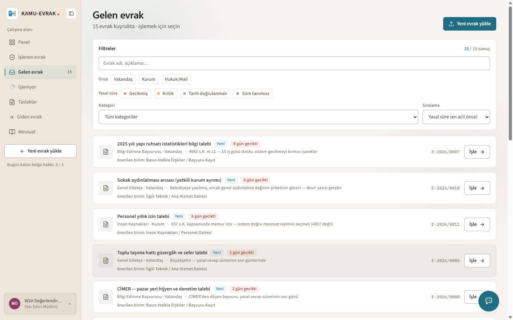

Incoming documents, ordered by legal urgency rather than arrival time. Each row already
carries a proposed responsible unit before anyone opens it. Filters by citizen /
institution / legal-financial, and by deadline status.

---

## 05 — The pipeline, live  ⭐ **the key frame**

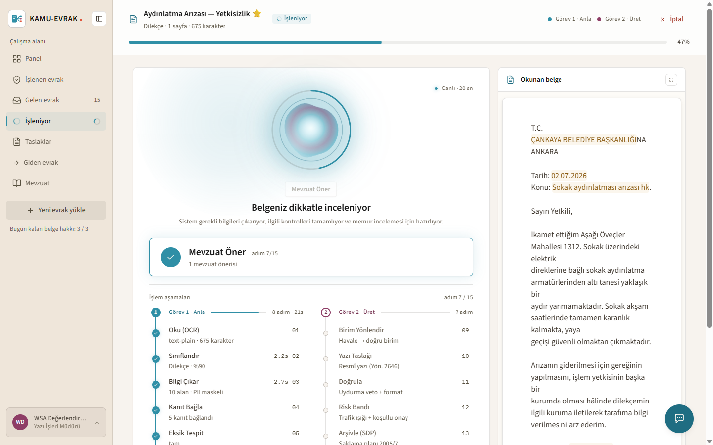

The officer watches the analysis happen, step by step, with the source document beside
it. This is the opposite of a black box: each step reports what it found.

- `Classify — Petition · 90%`
- `Extract — 10 fields · personal data masked`
- `Link evidence — 5 items grounded`

Two parallel tracks: **Task 1 · Understand** and **Task 2 · Produce**.

---

## 06 — It caught that the municipality was the wrong authority  ⭐

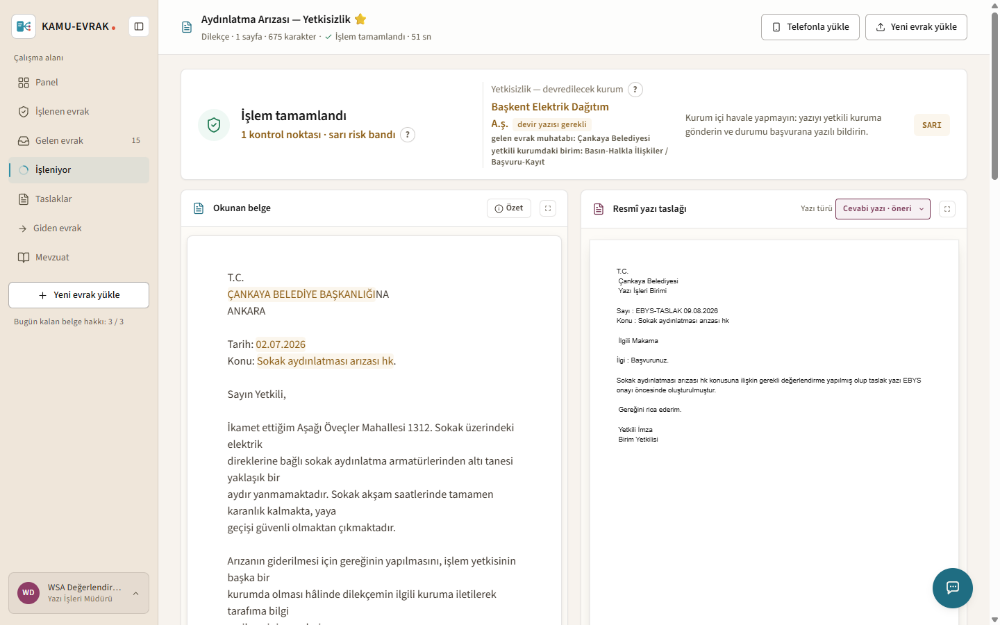

**Completed in 51 seconds.**

A citizen wrote to the municipality about broken street lighting. The system determined
that the municipality is **not** the competent authority, identified the correct one —
the regional electricity distribution company — and told the officer exactly what to do:

> *"Do not route this internally. Send the letter to the competent institution and
> notify the applicant in writing."*

It raised a **yellow risk band** rather than producing a confident wrong answer. On the
right: the drafted official letter in correct formal Turkish register.

This is the difference between a text generator and an administrative assistant.

---

## 07 — Full result view

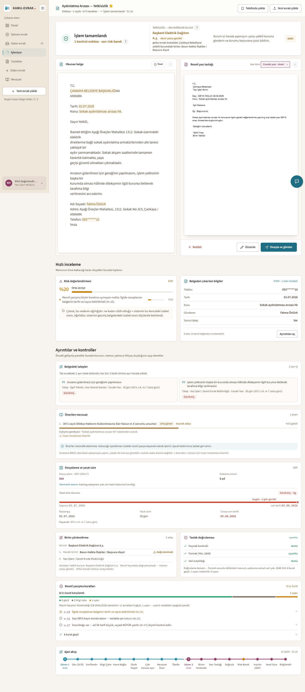

Source document, extracted fields, legal grounding, generated letter, risk assessment
and archival plan — on one screen, ready for the officer's decision.

---

## 08 — The officer's own archive

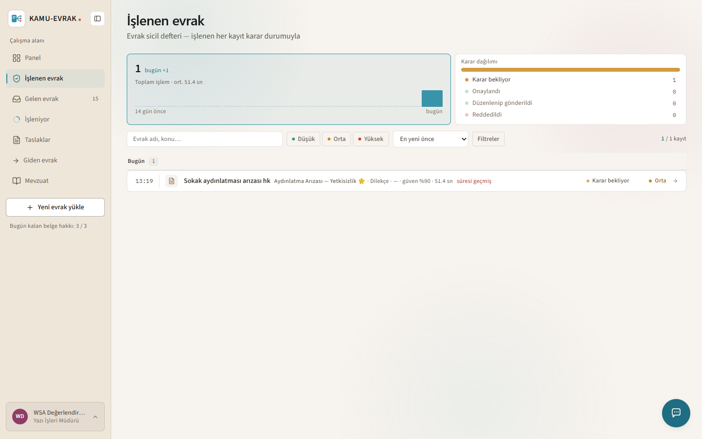

Processed documents persist in the user's account: what was decided, when, on what
grounds. Work is not lost between sessions.

---

## 09 — Legislation, browsable and citable

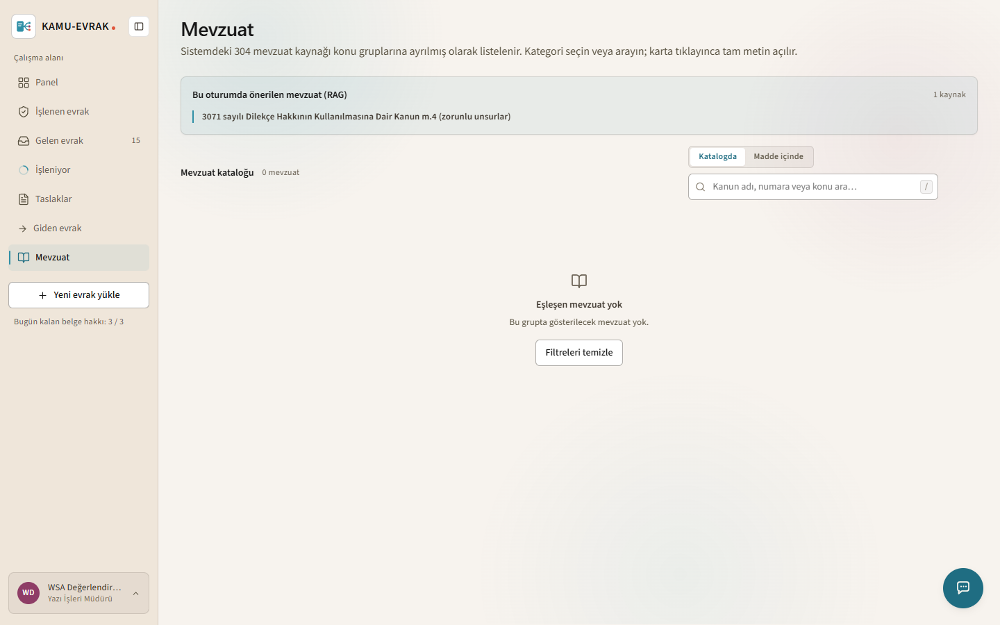

304 legislation sources. The assistant retrieves from this corpus and verifies every
citation against the source text — a reference it cannot ground is flagged in the
draft instead of being presented as fact.

---

## 10 — Tamper-evident audit trail

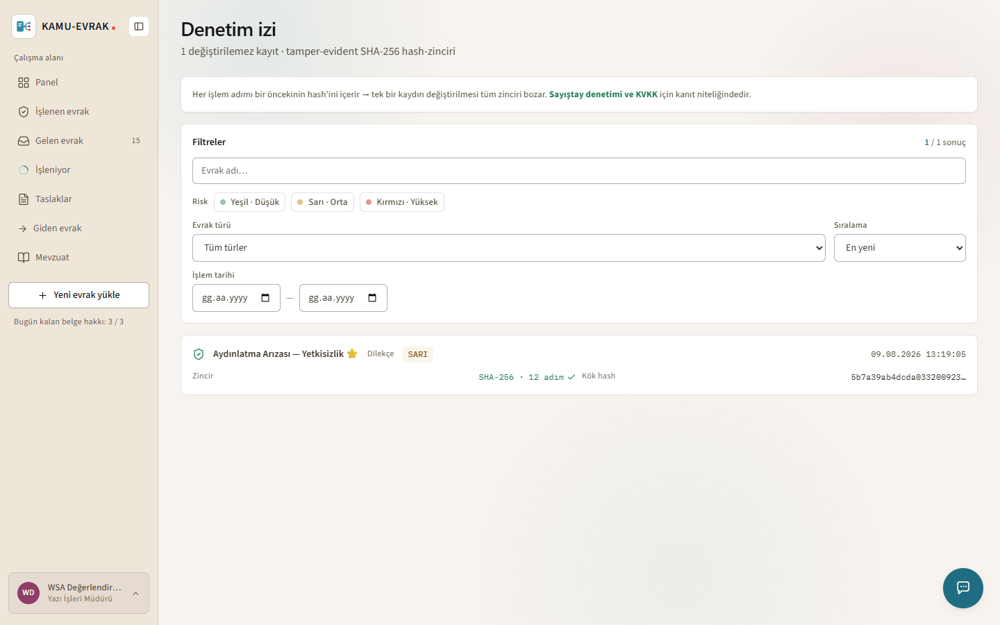

Every run produces a hash-chained record of each step. A decision can be reconstructed
and verified afterwards — an accountability requirement for public administration, not
a nice-to-have.

---

## 11 — Drafts awaiting the officer

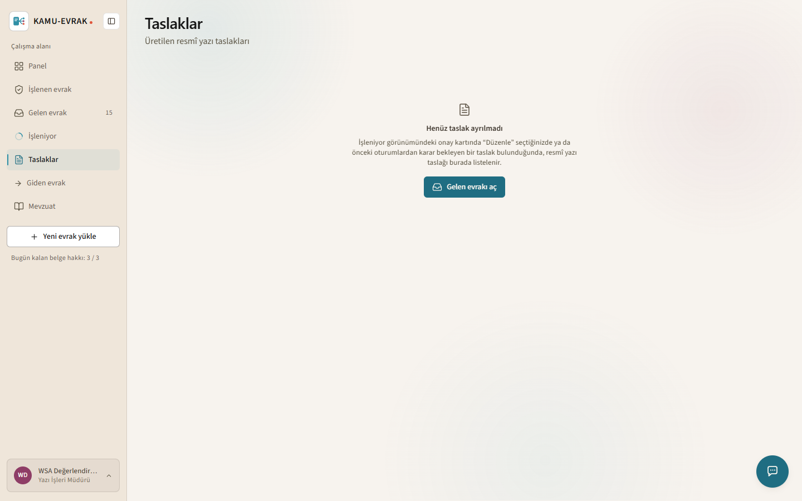

Nothing is sent automatically. Drafts wait in a queue; the officer approves, edits or
rejects. The system proposes — the human decides and signs.

---

## Notlar (forma yazılmayacak, sizin için)

**Neden bu sıra:** jüri yüzlerce başvuru okuyor. Anlatı tek belgenin yolculuğunu
izliyor, böylece teknik açıklama okumadan ne yaptığınızı anlıyorlar. 05 ve 06 asıl
etkileyici kareler — WSA formunda yer sınırlıysa **önce onları** koyun.

**06 neden en değerli kare:** "yanlış kurum" tespiti, sistemin yalnız metin üretmediğini,
idari yetki ilişkisini anladığını gösteriyor. Çoğu yapay zekâ demosunda bu yok.

**Kullanılan belge:** depodaki sentetik örnek evrak — gerçek vatandaş verisi değil.

**Kareler bayatlarsa:** arayüz değişirse yeniden çekilmeli. Çekim 9 Ağustos 2026.
