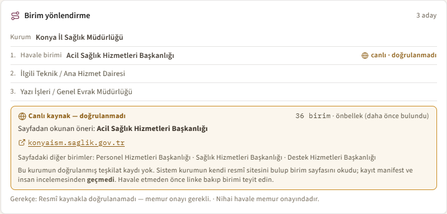

# Jüri Demo Senaryosu — kamu-evrak (TEKNOFEST 2026, 1. Senaryo)

> **Amaç:** 3-4 dakikada Görev 1 + Görev 2'yi uçtan-uca, **canlı (real-time)** göstermek.
> Demo puanı (15) burada kazanılır: "düşünen sistem" hissi (canlı ajan akışı) + somut çıktı
> (sınıflandırma → eksik tespit → mevzuat → birim havalesi → resmî yazı taslağı + indirme).
>
> **Veri kaynağı:** Tüm örnek evraklar **sahtedir** (kurgu isim/TCKN/telefon; gerçek kişiyle
> eşleşmez — şartname §6.5). Mevzuat alıntıları kamuya açık metinlerden.

---

## 0. Hazırlık (sahneye çıkmadan, ~2 dk)

```bash
# 1) Backend — mock modda (anahtar GEREKMEZ; node'lar deterministik fallback'e düşer)
cd backend
cp ../.env.example ../.env          # LLM_MODE=mock yeterli
uv run main.py                      # http://localhost:8000/docs — LAN açık (telefon QR çalışır)

# 2) Frontend — saf React/Vite (ek dep yok)
cd ../frontend
npm install
npm run dev                         # http://localhost:5173
```

Kontrol listesi:
- [ ] `http://localhost:8000/health` → `200 OK`
- [ ] `http://localhost:5173` açılıyor, başlık "kamu-evrak"
- [ ] Üst şeritte güvence rozetleri görünüyor: "2 görev tek pipeline · Kişisel veri maskeli · Karar destek"
- [ ] **Ekran çözünürlüğü ≥ 1280 px** (ajan akış şeması rahat görünsün)
- [ ] Tarayıcı zoom %100, sunum modunda bildirimler kapalı

---

## 1. Akış (canlı sunum, ~3 dk)

### Adım 1 — Açılış (15 sn)
> "Kamu kurumlarına günde binlerce evrak geliyor: dilekçe, başvuru, tebligat, üst yazı.
> kamu-evrak bunları **10 node'lu** bir boru hattından geçirip otomatik sınıflandırıyor,
> eksik bilgiyi yakalıyor, ilgili mevzuatı öneriyor, doğru birime havale ediyor ve
> **resmî yazı taslağını** üretiyor — hepsi canlı."

Üst şeritteki üç güvenceyi göster: **2 görev tek pipeline**, **kişisel veri maskeli**, **karar destek (uydurmasız)**.

### Adım 2 — Örnek evrak → canlı ajan akışı (60 sn)
- "Dosyan yok mu?" satırından **"Dilekçe"** örneğine tıkla.
- **Ajan Akış Şeması** canlanır: node'lar sırayla `oku → siniflandir → cikar → eksik_tespit →
  [mevzuat_oner ∥ ozetle] → route_birim → yazi_taslak → finalize` şeklinde "yanar".
- Vurgula: "Bu paralel kol — mevzuat önerisi ve özetleme aynı anda koşuyor."

### Adım 3 — Sonuç kartları (45 sn)
Sırayla göster:
1. **Evrak Türü** + güven yüzdesi (renkli ölçek).
2. **Çıkarılan Bilgi Unsurları** → 🛡️ **"Kişisel veri maskelendi"** rozeti; TCKN/telefon
   satırlarında **maskeli** etiketi. "Ham kişisel veri arayüze hiç ulaşmıyor; backend maskeliyor."
3. **Eksik Bilgi Kontrolü** → tam ise yeşil; eksikse turuncu çipler + clarify soruları.
4. **İlgili Mevzuat** → öneri + ilgililik skoru.
5. **Önerilen Havale Birimi** + alternatifler.

### Adım 4 — Görev 2: resmî yazı taslağı + indirme (45 sn)
- **Resmî Yazı Taslağı** kartında önizlemeyi göster (resmî üslup, EBYS/yetkili makamca
  tamamlanacak alanlar ham `{{ }}` görünmeden işaretlenir).
- **"DOCX indir"** (veya PDF) butonuna bas → dosya insin. "Memur taslağı düzenleyip
  gönderebilir; sistem ön hazırlığı yaptı."
- En altta **yasal disclaimer**: "Bu sistem karar-destek amaçlıdır; nihai sorumluluk
  yetkili personeldedir."

### Adım 4b — ⭐ Canlı kaynak keşfi (opsiyonel, 40 sn — **internet ister**)

> Bu adım sistemin en ayırt edici yeteneği: **korpusta olmayan bir kuruma evrak geldiğinde
> sistem o kurumun resmî sitesini CANLI bulup birim önerisini kaynağıyla gösteriyor.**

- Örnek: muhatabı **Konya İl Sağlık Müdürlüğü** olan bir evrak işle (bu kurumun
  doğrulanmış teşkilat kaydı YOK — 4066 kurumun 129'u doğrulanmış durumda).
- **Birim yönlendirme** kartında sarı panel açılır:
  - Öneri: **Acil Sağlık Hizmetleri Başkanlığı**
  - Kaynak: `konyaism.saglik.gov.tr/…-birimleri.html` ← **tıklanabilir**
  - Uyarı: *"Canlı kaynak — doğrulanmadı"*
- Söylenecek: *"Sistem kurumun adresini kalıptan türetti, birim sayfasını buldu, 36 birim
  okudu ve konuya uyanı önerdi — 1,2 saniyede. Ama **doğrulanmış demedi**: bu sayfa
  manifest ve insan incelemesinden geçmedi, o yüzden sarı ve memur onayı gerekiyor.
  Otomatik havale bu yoldan asla üretilmiyor."*
- Jüri "yanlış siteye düşmez mi?" derse: *"İki kapı var. `ttk.gov.tr` Türk **Tarih**
  Kurumu'na ait, bizim sicilde `ttk` Türkiye **Taşkömürü** Kurumu — kimlik kapısı sayfada
  kurum adını arıyor ve bunu reddediyor. İkincisi: merkez ilçe kaymakamlığı valiliğin
  adresine düşüyordu, o da aday üretiminde kapatıldı."*

> **Yedek:** internet yoksa bu adımı ATLA. Önbellek doluysa (daha önce çalıştırıldıysa)
> ağa çıkmadan da gösterir — demo öncesi bir kez koşturup önbelleği ısıtmak en güvenlisi.

Ekranda göreceğiniz kart (gerçek koşumdan alınmıştır):



### Adım 5 — Eksik-bilgi senaryosu (opsiyonel, 30 sn)
- **"Şikâyet (eksik)"** örneğine tıkla → sistem zorunlu alan eksikliğini yakalar,
  **clarify soruları** üretir. "Sistem körlemesine yazı üretmez; eksikse vatandaştan ister."

> **Not (indirme):** PDF/DOCX indirme **örnek-evrak** akışında etkindir (metin client'ta var).
> Dosya **yükleme** yolunda taslak **Kopyala** ile alınır; kart bunu açıkça belirtir.

---

## 2. ⚠️ İnternet-kesinti / arıza yedeği

Jüri canlı çalıştırma isteyebilir (§7-8); şebeke düşse bile demo durmaz:

| Risk | Yedek |
|---|---|
| İnternet yok / bulut API erişilemez | **`LLM_MODE=mock`** zaten varsayılan → hiçbir dış çağrı yok; node'lar deterministik keyword/regex fallback'e düşer. Demo offline tam çalışır. |
| OCR ağır model indiremiyor | **Örnek evraklar JSON yolundan** gider (OCR'sız) → tek tıkla 5 evrak türü çalışır. |
| `npm install` ağ hatası | `frontend/` build'i önceden alınmış `dist/` ile `npm run preview` koşulabilir; ya da dev sunucu zaten ayakta tutulur. |
| Backend çökerse | Frontend kullanıcıya net hata gösterir ("backend çalışıyor mu?"); backend yeniden başlatılır (`uvicorn ... --reload`). |
| Sunum makinesinde Python/uv yok | Hazır kayıt (ekran videosu/GIF) yedeği — `docs/img/` altında; kayıttan oynat, ardından canlı dene. |

**Altın kural:** Demo'yu **`LLM_MODE=mock` + örnek evraklar** ile sun → sıfır dış bağımlılık,
deterministik, internet kesintisinden etkilenmez. Bulut LLM (openai) yalnız "kalite tavanı"
göstermek için açılır; zorunlu değildir.

---

## 3. Konuşma noktaları (jüri sorusu gelirse)

- **"Skorlar?"** → `docs/benchmark/scorecard.md` (GERÇEK pipeline · **ölçüm modeli** DeepSeek-chat
  — 24 Tem 2026'da API'den kaldırıldı, üretim `deepseek-v4-flash`; skorlar yeniden ölçülmedi
  · in-domain, n=54):
  sınıflandırma macro-F1 **0.817** / accuracy **0.796**, yönlendirme Top-1 **0.852** /
  Top-3 **0.963**, eksik-bilgi recall(β=2) **0.739**, özet key-fact recall **0.712**,
  faithfulness **1.000**, adillik (counterfactual) **0.944**, false-veto **0/140**.
  "Dairesel-olmayan held-out (n=108, 2 bağımsız set): macro-F1 **~0.89** (0.864/0.907), yönlendirme
  Top-1 **0.907** — üretim modeli DeepSeek-chat." %95 Wilson güven aralıkları küçük-N
  belirsizliğini dürüstçe gösterir. Taslakta `format_uyumlu_rate=1.0`; ham `{{ }}` alanları
  jüri önizlemesinde görünmez.
- **"Uydurma riski?"** → Mevzuat madde/karar şüpheliyse `[DOĞRULA: ...]` placeholder; verify/risk
  guard uydurma kurum/tarih/sayıyı veto eder; her çıktıda disclaimer.
- **"KVKK / kişisel veri?"** → TCKN/telefon backend'de maskelenir; ham PII arayüze hiç ulaşmaz
  (kart üstündeki 🛡️ rozet bunun görünür kanıtı).
- **"Kaç kurumu biliyorsunuz?"** → Sicil **4066 kurum** tanır. Bunların **129'u** manifest +
  SHA-256 + insan doğrulamalı teşkilat kaydına sahip (**2053 birim**); **2210'u** mevzuat
  şablonu kapsamında (5393 belediye, 124 s. KHK üniversite, MEB il müdürlüğü…). Kalanına
  evrak gelirse **canlı kaynak keşfi** devreye girer (Adım 4b). Yani hiçbir kurum
  cevapsız kalmıyor — ama her cevabın **güven seviyesi ayrı ayrı gösteriliyor**:
  yeşil "kaynak doğrulandı" · sarı "canlı kaynak, doğrulanmadı" · "memur onayı gerekli".
- **"Test/build?"** → backend `uv run pytest -q` → **2346 passed**;
  frontend `npm test` → **361 passed**, `npm run build` → **başarılı**; `ruff check` temiz;
  veri kalite kapısı **GEÇTİ**.
